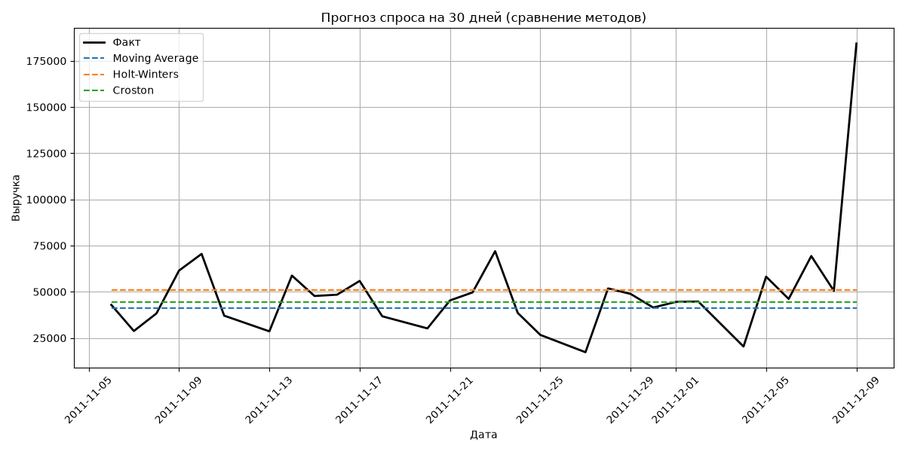
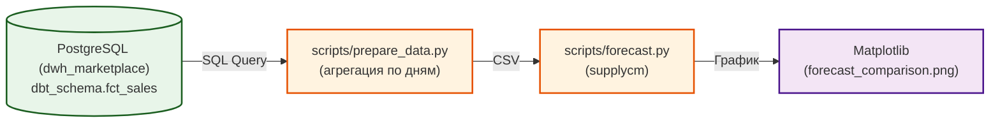

# 📈 Demand Forecasting Demo

Pet-проект: прогнозирование ежедневной выручки (спроса) на Python. Демонстрирует навыки работы с временными рядами и библиотекой `supplycm`.

## 📸 Скриншот

**Сравнение методов прогнозирования (MAPE):**


## 🎯 Зачем это

В ритейле и e-commerce важно понимать, сколько товара (или выручки) будет завтра, через неделю, через месяц. Для этого используются методы прогнозирования временных рядов. Этот проект показывает, как применить три разных алгоритма к реальным данным о продажах и сравнить их точность.

## 📖 Алгоритмы (шпаргалка)

| Метод | Что делает | Когда использовать |
| :--- | :--- | :--- |
| **Moving Average** (Скользящее среднее) | Усредняет последние N значений (окно). | Для стабильных данных без трендов и сезонности. |
| **Holt-Winters** (Экспоненциальное сглаживание с трендом и сезонностью) | Учитывает уровень, тренд и сезонность. | Для данных с четкой сезонностью (например, недельной). |
| **Croston's Method** | Разделяет спрос на «размер» и «интервал между покупками». | Для «рваного» (прерывистого) спроса, когда много нулей. |

## 🏗 Архитектура



## 📂 Структура

```
demand-forecasting-demo/
├── scripts/
│   ├── prepare_data.py    # Выгрузка данных из PostgreSQL
│   └── forecast.py        # Прогнозирование (supplycm)
├── data/
│   ├── daily_revenue.csv  # Выгруженные данные
│   └── forecast_comparison.png  # График
├── README.md
└── requirements.txt
```

## 🚀 Запуск

1. Установи зависимости:
```bash
pip install pandas supplycm matplotlib
```

2. Выгрузи данные:
```bash
python scripts/prepare_data.py
```

3. Построй прогноз:
```bash
python scripts/forecast.py
```

## 📊 Результаты

- **Обучающая выборка:** 275 дней (декабрь 2010 — ноябрь 2011).
- **Тестовая выборка:** 30 дней (ноябрь-декабрь 2011).
- **MAPE (Moving Average):** 30.56%
- **MAPE (Holt-Winters):** 37.36%
- **MAPE (Croston):** 31.07%

**Вывод:** Лучший результат показал метод Moving Average. Holt-Winters оказался хуже, потому что в тестовом периоде не было ярко выраженной сезонности, зато был резкий всплеск выручки, который не уловила ни одна модель.

## 🔗 Связанные проекты

- [`marketplace-dwh-analytics`](https://github.com/nconichtchenko-arch/marketplace-dwh-analytics) — источник данных (fct_sales).
- [`marketing-analytics-demo`](https://github.com/nconichtchenko-arch/marketing-analytics-demo) — маркетинговые метрики (ROMI, CTR).

## 📫 Контакты

- **GitHub:** [github.com/nconichtchenko-arch](https://github.com/nconichtchenko-arch)
- **Email:** pavloni@mail.ru
- **Формат работы:** удалённо